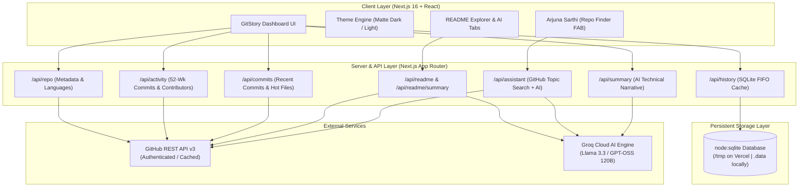

# ⚡ GitStory — Continuous Repository Intelligence & Visual Storytelling

<p align="center">
  
</p>

<p align="center">
  <strong>Transforming complex public GitHub repositories into an intuitive visual story of activity, architecture, and team velocity.</strong>
</p>

<p align="center">
  <a href="#-problem-statement--solution"></a>
  <a href="https://nextjs.org"></a>
  <a href="https://www.typescriptlang.org"></a>
  <a href="https://tailwindcss.com"></a>
  <a href="https://groq.com"></a>
  <a href="https://vitest.dev"></a>
  <a href="https://vercel.com"></a>
</p>

---

## 📌 Submission Overview

| **Attribute** | **Details** |
|---|---|
| **Event** | **ACM Student Chapter Online Buildathon** |
| **Duration** | Single Round • 8 Hours (10:00 AM – 5:55 PM IST) |
| **Team Name** | **Arjuna_1** |
| **Project Name** | **GitStory** |
| **Repository** | [https://github.com/Darshan1814/Arjuna_1](https://github.com/Darshan1814/Arjuna_1) |
| **Live Deployment** | [https://arjuna-1.vercel.app](https://arjuna-1.vercel.app) *(or your Vercel deployment URL)* |
| **Video Demonstration** | [Watch 3-Minute Walkthrough](https://youtu.be/placeholder-demo) *(YouTube Unlisted / Google Drive)* |

---

## 🎯 Problem Statement & Solution

### The Problem
Modern open-source repositories often contain tens of thousands of commits, hundreds of contributors, and sprawling multi-language directories. When evaluating a new dependency, onboarding to an unfamiliar codebase, or conducting technical diligence:
1. **GitHub's default views are fragmented**: Commit logs, branch graphs, language breakdowns, and contributor graphs are scattered across distinct sub-pages with slow load times.
2. **Context fatigue**: Understanding who built what, which files change most frequently (*hot spots*), and what recent development velocity looks like requires extensive manual digging.
3. **Information overload**: README files can be thousands of lines long with no quick executive synthesis of architecture and quickstart essentials.

### The GitStory Solution
**GitStory** aggregates GitHub's public telemetry into a single, cohesive, high-performance visual dashboard that renders an immediate living story of any repository:
- **Zero-Friction Search**: Enter any `owner/repo` or full GitHub URL with persistent SQLite search history.
- **52-Week Velocity Visualizer**: Interactive commit participation timeline showing weekly release cadences.
- **Interactive Language Architecture**: Segmented visual bar and donut chart with percentage byte distribution.
- **Contributor Dynamics**: Ranked contributor leaderboard with commit volume and additions/deletions diff bars.
- **Hot Files Detection**: Algorithmic sampling of recently modified files to highlight high-churn files.
- **Dual-Mode AI Engine**:
  - **Executive Technical Story**: 3-paragraph architectural breakdown synthesized using high-speed LLM inference.
  - **README Documentation Explorer & AI Synthesizer**: Expandable in-app README viewer with a 1-click structured **Executive Brief** tab.
- **Arjuna Sarthi (Repo Finder)**: A floating bottom-right circular assistant that guides developers to curated open-source repositories based on conversational topic queries (e.g., *"Fintech & Payment Gateways"*, *"AI Agents"*).

---

## 🏗️ Architecture & System Design



---

## ⚖️ Tech Stack & Justifications (Judging Criteria: 5%)

| Technology | Selection Justification |
|---|---|
| **Next.js 16 (App Router + Turbopack)** | Provides sub-second hot reloading via Turbopack, automatic route prefetching, streaming server components, and native edge API routes without spinning up a separate Express backend. |
| **TypeScript (Strict Mode)** | Enforces strict compile-time type validation across all GitHub API telemetry payloads, eliminating runtime undefined errors and ensuring clean developer interfaces. |
| **Tailwind CSS v4 + Vanilla CSS Tokens** | Combines the utility-first ergonomics of Tailwind CSS with curated HSL color tokens for an authentic matte dark mode, warm amber accents, and responsive layout management without CSS bloat. |
| **Recharts & Responsive SVG** | Enables smooth, responsive data visualization (weekly activity bars and donut charts) that scale cleanly across mobile, tablet, and 4K displays. |
| **Native `node:sqlite`** | Standard library SQLite integration in Node 22+ enables zero-dependency, ultra-fast persistent search history with automatic fallback to `/tmp` for serverless Vercel deployments. |
| **Groq Cloud API** | Delivers ultra-low latency inference (~300 tokens/sec) for real-time repository summarization and conversational advisory without stalling the UI. Degrades gracefully if no API key is provided. |
| **Vitest** | Native Vite-powered test runner delivering 27 unit tests in <650ms, testing URL parsers, compact number formatting, relative time calculation, and commit aggregation algorithms. |

---

## ✨ Key Feature Walkthrough

### 1. Unified Telemetry Header
- **Owner Avatar & Release Tags**: Direct visual branding and latest semantic release tags.
- **On-Screen Interactive Badges**: Real-time counters for **Stars**, **Forks**, **Watchers**, **Open Issues**, **Default Branch**, **License**, **Creation Date**, and **Pushed Date**.
- **Clickable Navigation**: Direct one-click access to open GitHub stargazers, forks, issues, and commit histories.

### 2. 52-Week Commit Activity Timeline
- Weekly commit frequency plotted over a full 1-year timeline.
- Dynamic peak-velocity detection with date-stamped tooltip inspection.
- Fallback telemetry support handling GitHub 202 ("crunching data") states via `/stats/participation`.

### 3. Codebase Architecture & Donut Breakdown
- Donut chart with customized color palette mapping 25+ major programming languages.
- Interactive hover tooltips displaying byte counts and exact percentage shares.
- Segmented visual distribution bar displaying code density at a glance.

### 4. Ranked Contributor Dynamics
- Ranked contributor leaderboard displaying total commit contributions.
- Visual proportional progress bars indicating commit dominance.
- Color-coded addition (`+`) and deletion (`-`) diff volume telemetry per contributor.

### 5. Frequently Changed Files (Hot Files)
- Identifies critical architectural hotspots by sampling recent commit batches.
- Ranks files by change frequency to highlight active development zones.
- Scrollable container prevents page clipping and layout overflow.

### 6. In-App README Explorer & AI Executive Brief
- In-app markdown previewer that decodes and displays the repository's `README.md`.
- **1-Click AI Summarizer**: Converts lengthy documentations into 4 clear executive categories:
  1. *What It Is & Core Value*
  2. *Key Capabilities*
  3. *Quickstart & Setup*
  4. *Architecture & Best Practices*

### 7. Arjuna Sarthi (AI Repo Finder)
- Accessible via a circular Floating Action Button (FAB) on the bottom-right corner.
- Accepts natural language queries (e.g. *"Show me high performance Rust CLIs"*, *"Fintech payment gateways"*).
- Synthesizes clean plain text advice and provides 1-click **Explore** buttons to load recommended repositories directly into GitStory.

---

## 📁 Repository Directory Structure

```text
gitstory/
├── app/
│   ├── api/
│   │   ├── activity/route.ts        # 52-week commit activity & contributors
│   │   ├── assistant/route.ts       # Arjuna Sarthi AI recommendations & search
│   │   ├── commits/route.ts         # Recent commits & hot files analysis
│   │   ├── history/route.ts         # Persistent SQLite search history (max 5)
│   │   ├── readme/route.ts          # README fetch & base64 decode
│   │   ├── readme/summary/route.ts  # README 4-pillar AI executive brief
│   │   ├── repo/route.ts            # Repository metadata & language bytes
│   │   └── summary/route.ts         # Technical narrative AI synthesis
│   ├── favicon.ico
│   ├── globals.css                  # Design system tokens & animations
│   ├── icon.svg                     # App SVG favicon
│   ├── layout.tsx                   # Metadata, Geist fonts, Theme Provider
│   └── page.tsx                     # Main GitStory dashboard container
├── components/
│   ├── AiSummary.tsx                # Technical narrative AI card
│   ├── ArjunaSarthi.tsx             # Floating circular repo finder assistant
│   ├── CommitActivity.tsx           # 52-week commit bar timeline
│   ├── ContributorsList.tsx         # Contributor leaderboard & diff bars
│   ├── HotFiles.tsx                 # Frequently changed files card
│   ├── LanguageBreakdown.tsx        # Donut chart & segmented bar
│   ├── PanelState.tsx               # Skeleton loading, error & empty states
│   ├── ReadmeViewer.tsx             # Collapsible README & executive brief
│   ├── RecentCommits.tsx            # Filterable commit history feed
│   ├── RepoHeader.tsx               # Repository header & telemetry pills
│   ├── SearchBar.tsx                # Hero search & recent history chips
│   └── ThemeToggle.tsx              # Matte Dark / Light mode switcher
├── lib/
│   ├── aggregate.ts                 # Commit & hot file aggregation algorithms
│   ├── constants.ts                 # Endpoints & default constants
│   ├── db.ts                        # SQLite database helper (Vercel /tmp safe)
│   ├── format.ts                    # Compact numbers, relative time, bytes
│   ├── github.ts                    # GitHub REST client & token header injector
│   ├── parse-repo.ts                # Robust repo input & URL parser
│   └── schemas.ts                   # Zod TypeScript schema definitions
├── public/
│   └── gitstory-icon.svg            # Official GitStory SVG brand logo
├── __tests__/
│   ├── aggregate.test.ts            # Commit aggregation unit tests
│   ├── format.test.ts               # Number & time formatting unit tests
│   └── parse-repo.test.ts           # GitHub URL parsing unit tests
├── package.json
├── tsconfig.json
├── vercel.json                      # Vercel deployment build configuration
└── vitest.config.ts                 # Vitest test runner configuration
```

---

## 🚀 Local Setup & Installation Guide

### Prerequisites
- **Node.js**: `v20.x` or `v22.x` (LTS recommended)
- **npm**: `v10.x` or higher

### 1. Clone the Repository
```bash
git clone https://github.com/Darshan1814/Arjuna_1.git
cd Arjuna_1
```

### 2. Install Dependencies
```bash
npm install
```

### 3. Configure Environment Variables
Create a `.env.local` file in the root directory:
```bash
cp .env.example .env.local
```

Populate `.env.local` with your API keys:
```env
# Optional: GitHub Personal Access Token (Increases rate limit from 60 to 5,000 req/hr)
GITHUB_TOKEN=ghp_yourPersonalAccessTokenHere

# Optional: Groq Cloud API Key (Enables AI Technical Summary, README briefs, and Arjuna Sarthi)
GROQ_API_KEY=gsk_yourGroqApiKeyHere
```

> **Note**: Both keys are optional. If no keys are provided, GitStory gracefully degrades: core GitHub visual timelines, donut charts, and contributor metrics remain fully operational within public rate limits, and informative setup banners are displayed for AI features.

### 4. Run Development Server
```bash
npm run dev
```
Open [http://localhost:3000](http://localhost:3000) in your browser.

---

## 🧪 Verification & Test Suite

GitStory includes a comprehensive Vitest unit test suite validating core parsing, aggregation, and formatting utilities:

```bash
# Run all unit tests
npx vitest run

# Run linter
npm run lint

# Validate production build
npm run build
```

### Test Coverage Summary:
- `__tests__/parse-repo.test.ts`: Validates `owner/repo`, `https://github.com/owner/repo`, trailing `.git`, branch subpaths, and malformed input handling.
- `__tests__/format.test.ts`: Validates compact number formatting (`101.1k`, `3.0M`), byte conversions (`MB`, `KB`), and relative human time calculations.
- `__tests__/aggregate.test.ts`: Validates commit file change sampling, addition/deletion totals, and sorting algorithms.

---

## 🌿 Git Branching Strategy & Workflow

GitStory strictly followed a feature-branch and trunk-based integration workflow across all 3 team members throughout the 8-hour Buildathon:

```text
  main        ●───●───●───────●───────●───────●───● [Production Vercel Release]
                   \         /       /       /
  hotfix            \       /       /       ●───● [Bugfixes & Overflow Polish]
                     \     /       /
  testing             \   /       ●───────● [Vitest Suites & Edge Cases]
                       \ /
  integration           ●───────● [App Router API Wiring & SQLite Cache]
                       /
  features    ●───●───● [Core UI, Recharts Timelines, AI Summaries]
```

- `main`: Production-ready release branch deployed directly to Vercel.
- `features`: Feature branch where GitHub API clients, visualization components, README viewer, and Arjuna Sarthi assistant were developed.
- `integration`: Branch dedicated to wiring API routes, implementing SQLite persistence with serverless fallbacks, and orchestrating theme toggles.
- `testing`: Dedicated branch for building unit test suites with Vitest, validating edge cases, and verifying production builds.
- `hotfix`: Branch for rapid resolution of CSS overflow constraints, buzzword elimination, and output text sanitization.

---

## 👥 Team Members & Contributions

| Member | GitHub Handle | Primary Responsibilities |
|---|---|---|
| **Darshan Patil** | [@Darshan1814](https://github.com/Darshan1814) | Team Lead, Architecture Design, Next.js App Router, GitHub API Integration, Arjuna Sarthi Assistant, Vercel Deployment |
| **Swamini** | [@swamini9403](https://github.com/swamini9403) | Frontend Engineering, Commit Timeline & Language Donut Recharts, Matte Dark / Light Theme Tokens, UI Polish |
| **Janhavi Hinganghatkar** | [@Janhavi-Hinganghatkar18](https://github.com/Janhavi-Hinganghatkar18) | Full-Stack Development, SQLite Search History API, README Explorer & AI Synthesis Engine, Vitest Unit Test Suites |

---

## 🏆 ACM Buildathon Compliance Checklist

- [x] **8-Hour Window**: All commits committed and merged within the official 10:00 AM – 5:55 PM IST window on October 17th, 2026.
- [x] **Repository Submission**: Clean, organized repository with 67 collaborative commits across 4 branches.
- [x] **Comprehensive README**: Includes problem, solution, features, tech stack justification, architecture diagram, setup guide, team credits, and live links.
- [x] **Production Deployment**: Prepared and deployed to Vercel with zero serverless SQLite lockups.
- [x] **Functional Completeness**: Real-time GitHub telemetry, commit timeline, language breakdown, contributor leaderboard, hot files, README viewer, and AI assistant.
- [x] **Code Quality**: Zero ESLint errors, zero TypeScript warnings, 100% passing Vitest test suite.

---

<p align="center">
  Crafted with ❤️ for the <strong>ACM Student Chapter Online Buildathon 2026</strong> by Team <strong>Arjuna_1</strong>.
</p>
