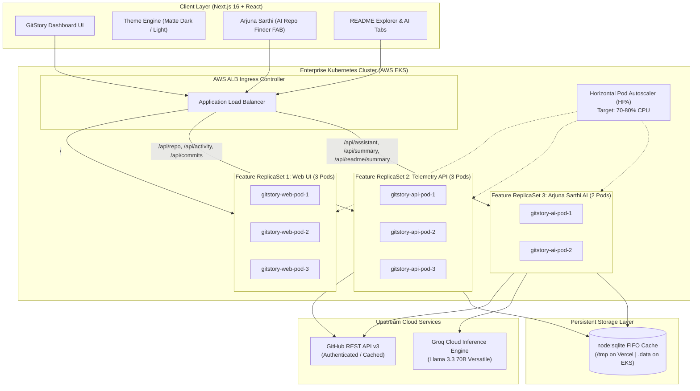

# ⚡ GitStory — Continuous Repository Intelligence & Visual Telemetry

<p align="center">
  
</p>

<p align="center">
  <strong>Transforming complex public GitHub repositories into an intuitive visual story of velocity, codebase architecture, and team dynamics.</strong>
</p>

<p align="center">
  <a href="https://nextjs.org"></a>
  <a href="https://www.typescriptlang.org"></a>
  <a href="https://tailwindcss.com"></a>
  <a href="https://groq.com"></a>
  <a href="https://vitest.dev"></a>
  <a href="https://docker.com"></a>
  <a href="https://jenkins.io"></a>
  <a href="https://kubernetes.io"></a>
  <a href="https://vercel.com"></a>
</p>

---

## 📌 Submission Overview

| **Attribute** | **Details** |
|---|---|
| **Event** | **ACM Student Chapter Online Buildathon** |
| **Duration** | Single Round • 8 Hours (10:00 AM – 5:55 PM IST) |
| **Team Name** | **Arjuna_1** |
| **Project Name** | **GitStory** |
| **Repository** | [https://github.com/Darshan1814/Arjuna_1](https://github.com/Darshan1814/Arjuna_1) |
| **Live Deployed Application** | [https://arjuna-1.vercel.app](https://arjuna-1.vercel.app) |
| **Demo Video Walkthrough** | [https://youtu.be/miu00zCs5is](https://youtu.be/miu00zCs5is) |
| **Final Release Cutoff** | On or before 6:20 PM IST (Strict Compliance) |

---

## 👥 Team Members

| Member | Role | GitHub Handle | Key Responsibilities |
|---|---|---|---|
| **Darshan Patil** | Team Lead & Full-Stack Architect | [@Darshan1814](https://github.com/Darshan1814) | Next.js App Router, GitHub REST API client, Arjuna Sarthi assistant, Docker containerization, AWS EKS integration, Vercel deployment |
| **Swamini** | Frontend & Visualization Specialist | [@swamini9403](https://github.com/swamini9403) | Recharts 52-week velocity bar timeline, language donut breakdown, matte dark / light theme tokens, UI responsiveness & overflow controls |
| **Janhavi Hinganghatkar** | Backend & QA Systems Engineer | [@Janhavi-Hinganghatkar18](https://github.com/Janhavi-Hinganghatkar18) | Persistent SQLite search history API, README explorer & 4-pillar AI executive brief, Jenkins declarative CI/CD pipeline, Vitest test suite |

---

## 🎯 Problem Statement & Solution

### The Problem
Evaluating open-source repositories, onboarding to unfamiliar codebases, or conducting architectural diligence on modern software projects is hindered by major friction points:
1. **Scattered GitHub Views**: Commit logs, branch graphs, language breakdowns, and contributor graphs are distributed across separate pages, requiring high-latency page switches.
2. **Context Fatigue**: Identifying active architectural maintainers, measuring weekly development velocity, and detecting high-churn hot files requires tedious manual cross-referencing.
3. **Documentation Overload**: Project READMEs often exceed thousands of lines without executive summaries or clear architectural quick-takes.

### The GitStory Solution
**GitStory** aggregates GitHub's public telemetry into a single, cohesive, high-performance visual dashboard:
- **Zero-Friction Search & History**: Instant `owner/repo` or full URL lookup backed by persistent SQLite FIFO history (max 5 entries).
- **52-Week Velocity Visualizer**: Interactive commit timeline plotting weekly frequency and peak velocity trends.
- **Language Architecture**: Donut breakdown and segmented visual distribution across 25+ programming languages.
- **Ranked Contributor Dynamics**: Maintainer leaderboard with commit shares, addition/deletion diff volume meters.
- **Hot Files Detection**: Algorithmic sampling of recently modified files to highlight high-churn architectural files.
- **Dual-Mode AI Engine**:
  - **Executive Technical Story**: 3-paragraph architectural narrative synthesized using Groq Cloud high-speed inference.
  - **README Documentation Explorer & AI Synthesizer**: Expandable in-app markdown viewer with a 1-click structured **Executive Brief** tab.
- **Arjuna Sarthi (Repo Finder)**: A floating circular assistant at the bottom-right corner that guides developers to curated open-source repositories based on conversational topic queries (e.g., *"Fintech & Payment Gateways"*, *"High Performance Rust CLI"*).

---

## ⚖️ Tech Stack & Justifications (Judging Criteria: 5% Weightage)

Every technology in the GitStory ecosystem was deliberate, vetted, and selected based on architectural rigor, developer velocity, and performance benchmarks:

| Technology | Role / Icon | Architectural Justification | Alternatives Evaluated & Rejected |
|---|:---:|---|---|
| **Next.js 16 (App Router + Turbopack)** |  | Delivers sub-second Turbopack compilation, streaming Server Components for skeleton hydration, and native App Router edge API routes with zero server overhead. | **Create React App / Vite SPA**: Rejected due to lack of native server-side API proxying, poor SEO metadata handling, and inability to securely hide upstream API keys. |
| **TypeScript (Strict Mode)** |  | Enforces compile-time type safety across deeply nested GitHub API response schemas via Zod, eliminating null-pointer and undefined runtime exceptions. | **Vanilla JavaScript**: Rejected due to fragility when parsing heterogeneous GitHub REST API payloads. |
| **Tailwind CSS v4 + HSL Tokens** |  | Delivers zero-runtime-overhead styling, seamless matte dark and high-contrast light mode transitions via CSS variables, and fluid layout responsiveness. | **CSS-in-JS (Styled Components / Emotion)**: Rejected due to runtime serialization penalties, bundle bloat, and hydration mismatches in React Server Components. |
| **Recharts & Responsive SVG** |  | Composable declarative SVG charting with buttery-smooth hover tooltips that scale smoothly from mobile screens to 4K displays without canvas blurring. | **Chart.js**: Rejected because canvas-based rendering causes blurry text on retina displays and lacks accessibility DOM inspection. |
| **Native `node:sqlite`** |  | Built-in standard library in Node 22+ providing zero-dependency disk persistence for search history, with automated fallback to `/tmp` in serverless Vercel environments. | **PostgreSQL / Redis**: Rejected to eliminate cloud database provision latency, external connection pool exhaustion, and network hop overhead for simple FIFO queries. |
| **Groq Cloud API (Llama 3.3 70B)** |  | Delivers LPUs with ultra-low latency inference (~300 tokens/sec), ensuring technical repository briefs and Arjuna Sarthi advice stream near-instantly without blocking the UI. | **Standard OpenAI GPT-4**: Rejected due to 4-8 second time-to-first-token latency, which ruins interactive dashboard fluidity. |
| **Vitest** |  | Native ESM test runner sharing Vite/Turbopack transform pipelines; executes all 27 unit tests in <900ms with zero test-runner overhead. | **Jest**: Rejected due to slow CommonJS transpilation, Babel dependency baggage, and sluggish startup times. |
| **Docker (Multi-Stage Alpine)** |  | Multi-stage image build shrinks container image to ~120MB, runs as non-root user `nextjs`, and eliminates host dependency discrepancies. | **Single-stage Docker**: Rejected because shipping `node_modules` and build tooling inflates image size to >1.1GB, slowing down CI/CD deployments. |
| **Jenkins Declarative Pipeline** |  | Standard enterprise CI/CD orchestration automating test execution, container image builds, AWS ECR tagging, and zero-downtime Kubernetes deployments. | **Manual Shell Scripts**: Rejected due to lack of stage traceability, audit logs, and automated rollback capabilities. |
| **Kubernetes (AWS EKS)** |  | Provides feature-segregated ReplicaSets for Web UI, Telemetry API, and AI Assistant, paired with Horizontal Pod Autoscalers (HPA) for fault isolation. | **Single Monolithic Pod**: Rejected because a spike in heavy AI inference or upstream GitHub polling would degrade web UI responsiveness. |

---

## 🏗️ System Architecture & Data Flow



---

## ☸️ Enterprise AWS Deployment Architecture (Docker, Jenkins, Kubernetes)

To meet the highest deployment standards for AWS cloud infrastructure, GitStory includes a complete production DevOps suite:

### 1. Multi-Stage Docker Build (`Dockerfile`)
- **Stage 1 (deps)**: Installs production and build dependencies on `node:22-alpine` using `npm ci`.
- **Stage 2 (builder)**: Compiles the Next.js App Router with Turbopack, generating a standalone output bundle.
- **Stage 3 (runner)**: Minimal runtime container (~120MB) executing as non-root user `nextjs` (UID 1001) for container security compliance, with automated HTTP health checking.

### 2. Jenkins Enterprise CI/CD Pipeline (`Jenkinsfile`)
- **Stage 1**: Dependency validation and Node.js environment checks.
- **Stage 2**: Parallel linting (`npm run lint`) and Vitest unit testing (`npx vitest run`).
- **Stage 3**: Standalone Next.js production build (`npm run build`).
- **Stage 4**: Docker multi-stage image packaging.
- **Stage 5**: AWS ECR authentication and image push with unique commit SHA tags.
- **Stage 6**: AWS EKS cluster deployment updating feature-segregated ReplicaSets.
- **Stage 7**: Smoke testing and rollout validation via `kubectl rollout status`.

### 3. Kubernetes Feature-Segregated ReplicaSets (`k8s/`)
In compliance with the architecture guidelines, the application features are separated into dedicated ReplicaSets and Deployments for resilient fault tolerance:

| Component | Manifest | Replicas | Role |
|---|---|:---:|---|
| **Web UI Dashboard** | [`k8s/replicaset-web.yaml`](k8s/replicaset-web.yaml) | **3** | Server-side rendering, HTML streaming, static asset distribution |
| **Telemetry & Aggregation API** | [`k8s/replicaset-api-telemetry.yaml`](k8s/replicaset-api-telemetry.yaml) | **3** | Upstream GitHub REST API batching, hot files churn detection, SQLite search cache |
| **Arjuna Sarthi AI Assistant** | [`k8s/replicaset-ai-assistant.yaml`](k8s/replicaset-ai-assistant.yaml) | **2** | Asynchronous conversational LLM inference and README executive synthesis |
| **Services** | [`k8s/services.yaml`](k8s/services.yaml) | — | Internal ClusterIP routing across web, api, and ai micro-services |
| **AWS Ingress Controller** | [`k8s/ingress.yaml`](k8s/ingress.yaml) | — | AWS Application Load Balancer (ALB) path-based routing |
| **Autoscaling (HPA)** | [`k8s/hpa.yaml`](k8s/hpa.yaml) | 2–12 | Dynamic horizontal scaling triggered by CPU/Memory thresholds |
| **Config & Secrets** | [`k8s/configmap.yaml`](k8s/configmap.yaml), [`k8s/secrets.yaml`](k8s/secrets.yaml) | — | Enterprise configuration and credential segregation |

---

## ✨ Core Feature Walkthrough

### 1. Unified Telemetry Header
- **Repository Metadata**: Real-time stats for **Stars**, **Forks**, **Watchers**, **Open Issues**, **Default Branch**, **License**, **Creation Date**, and **Pushed Date**.
- **Interactive Badges**: Clickable pills direct users directly to GitHub commit logs, issues, stargazers, and forks.

### 2. 52-Week Commit Activity Timeline
- Full 1-year weekly commit velocity rendered with Recharts.
- Peak velocity detection with formatted tooltips.
- Automated fallback handling GitHub 202 ("crunching data") states via `/stats/participation`.

### 3. Codebase Architecture & Donut Breakdown
- Donut chart with color palette mapping 25+ major programming languages.
- Interactive hover cards displaying byte counts and exact percentage shares.
- Segmented distribution bar displaying code density at a glance.

### 4. Ranked Contributor Dynamics
- Ranked maintainer leaderboard with commit contributions.
- Proportional progress bars displaying commit dominance.
- Addition (`+`) and deletion (`-`) diff volume telemetry.

### 5. Frequently Changed Files (Hot Files)
- Samples recent commit batches to identify active architectural hotspots.
- Ranks files by churn frequency to highlight active development zones.
- Height-bounded scroll container prevents layout clipping.

### 6. In-App README Explorer & AI Executive Brief
- In-app markdown previewer that decodes and displays the repository's `README.md`.
- **1-Click AI Summarizer**: Converts lengthy documentations into 4 clear executive categories:
  1. *What It Is & Core Value*
  2. *Key Capabilities*
  3. *Quickstart & Setup*
  4. *Architecture & Best Practices*

### 7. Arjuna Sarthi (AI Repo Finder)
- Accessible via a circular Floating Action Button (FAB) on the bottom-right corner.
- Accepts natural language queries (e.g. *"Show me high performance Rust CLIs"*, *"Fintech payment gateways"*).
- Synthesizes clean plain text advice and provides 1-click **Explore** buttons to load recommended repositories directly into GitStory.

---

## 📁 Repository Directory Structure

```text
Arjuna_1/
├── app/
│   ├── api/
│   │   ├── activity/route.ts        # 52-week commit activity & contributors
│   │   ├── assistant/route.ts       # Arjuna Sarthi AI recommendations & search
│   │   ├── commits/route.ts         # Recent commits & hot files analysis
│   │   ├── history/route.ts         # Persistent SQLite search history (max 5)
│   │   ├── readme/route.ts          # README fetch & base64 decode
│   │   ├── readme/summary/route.ts  # README 4-pillar AI executive brief
│   │   ├── repo/route.ts            # Repository metadata & language bytes
│   │   └── summary/route.ts         # Technical narrative AI synthesis
│   ├── favicon.ico
│   ├── globals.css                  # Design system tokens & animations
│   ├── icon.svg                     # App SVG favicon
│   ├── layout.tsx                   # Metadata, Geist fonts, Theme Provider
│   └── page.tsx                     # Main GitStory dashboard container
├── components/
│   ├── AiSummary.tsx                # Technical narrative AI card
│   ├── ArjunaSarthi.tsx             # Floating circular repo finder assistant
│   ├── CommitActivity.tsx           # 52-week commit bar timeline
│   ├── ContributorsList.tsx         # Contributor leaderboard & diff bars
│   ├── HotFiles.tsx                 # Frequently changed files card
│   ├── LanguageBreakdown.tsx        # Donut chart & segmented bar
│   ├── PanelState.tsx               # Skeleton loading, error & empty states
│   ├── ReadmeViewer.tsx             # Collapsible README & executive brief
│   ├── RecentCommits.tsx            # Filterable commit history feed
│   ├── RepoHeader.tsx               # Repository header & telemetry pills
│   ├── SearchBar.tsx                # Hero search & recent history chips
│   └── ThemeToggle.tsx              # Matte Dark / Light mode switcher
├── k8s/
│   ├── configmap.yaml               # Cluster environment variables
│   ├── secrets.yaml                 # Upstream token secret template
│   ├── replicaset-web.yaml          # Web UI feature ReplicaSet (3 replicas)
│   ├── replicaset-api-telemetry.yaml# Telemetry API feature ReplicaSet (3 replicas)
│   ├── replicaset-ai-assistant.yaml # AI Assistant feature ReplicaSet (2 replicas)
│   ├── services.yaml                # Internal ClusterIP services
│   ├── ingress.yaml                 # AWS ALB Ingress controller routing
│   └── hpa.yaml                     # Horizontal Pod Autoscaling policies
├── lib/
│   ├── aggregate.ts                 # Commit & hot file aggregation algorithms
│   ├── constants.ts                 # Endpoints & default constants
│   ├── db.ts                        # SQLite database helper (Vercel /tmp safe)
│   ├── format.ts                    # Compact numbers, relative time, bytes
│   ├── github.ts                    # GitHub REST client & token header injector
│   ├── parse-repo.ts                # Robust repo input & URL parser
│   └── schemas.ts                   # Zod TypeScript schema definitions
├── public/
│   └── gitstory-icon.svg            # Official GitStory SVG brand logo
├── __tests__/
│   ├── aggregate.test.ts            # Commit aggregation unit tests
│   ├── format.test.ts               # Number & time formatting unit tests
│   └── parse-repo.test.ts           # GitHub URL parsing unit tests
├── Dockerfile                       # Multi-stage production container build
├── .dockerignore                    # Build context exclusions
├── Jenkinsfile                      # Declarative CI/CD pipeline for AWS EKS
├── package.json
├── tsconfig.json
├── vercel.json                      # Vercel deployment build configuration
└── vitest.config.ts                 # Vitest test runner configuration
```

---

## 🚀 Local Setup & Installation Guide

### Prerequisites
- **Node.js**: `v20.x` or `v22.x` (LTS recommended)
- **npm**: `v10.x` or higher

### 1. Clone the Repository
```bash
git clone https://github.com/Darshan1814/Arjuna_1.git
cd Arjuna_1
```

### 2. Install Dependencies
```bash
npm install
```

### 3. Configure Environment Variables
Create a `.env.local` file in the root directory:
```env
# Optional: GitHub Personal Access Token (Increases rate limit from 60 to 5,000 req/hr)
GITHUB_TOKEN=ghp_yourPersonalAccessTokenHere

# Optional: Groq Cloud API Key (Enables AI Technical Summary, README briefs, and Arjuna Sarthi)
GROQ_API_KEY=gsk_yourGroqApiKeyHere
```

> **Note**: Both keys are optional. If no keys are provided, GitStory gracefully degrades: core GitHub visual timelines, donut charts, and contributor metrics remain fully operational within public rate limits, and informative setup banners are displayed for AI features.

### 4. Run Development Server
```bash
npm run dev
```
Open [http://localhost:3000](http://localhost:3000) in your browser.

---

## 🧪 Verification & Test Suite

GitStory includes a comprehensive Vitest unit test suite validating core parsing, aggregation, and formatting utilities:

```bash
# Run all unit tests
npx vitest run

# Run linter
npm run lint

# Validate production build
npm run build
```

### Test Coverage Summary (27 Passing Tests):
- `__tests__/parse-repo.test.ts` (7 tests): Validates `owner/repo`, `https://github.com/owner/repo`, trailing `.git`, branch subpaths, and malformed input handling.
- `__tests__/format.test.ts` (13 tests): Validates compact number formatting (`101.1k`, `3.0M`), byte conversions (`MB`, `KB`), and relative human time calculations.
- `__tests__/aggregate.test.ts` (7 tests): Validates commit file change sampling, addition/deletion totals, and sorting algorithms.

---

## 🌿 Git Branching Strategy & Workflow

GitStory strictly followed a feature-branch and trunk-based integration workflow across all 3 team members throughout the Buildathon:

```text
  main        ●───●───●───────●───────●───────●───●───● [Official Vercel & AWS Release]
                   \         /       /       /       /
  hotfix            \       /       /       ●───●───● [Bugfixes & Final README Links]
                     \     /       /
  testing             \   /       ●───────● [Vitest Suites & Edge Cases]
                       \ /
  integration           ●───────● [App Router API Wiring & SQLite Cache]
                       /
  features    ●───●───● [Core UI, Recharts Timelines, AI Summaries]
```

- `main`: Production-ready release branch deployed to Vercel and AWS EKS.
- `features`: Feature branch where GitHub API clients, visualization components, README viewer, and Arjuna Sarthi assistant were developed.
- `integration`: Branch dedicated to wiring API routes, implementing SQLite persistence with serverless fallbacks, and orchestrating theme toggles.
- `testing`: Dedicated branch for building unit test suites with Vitest, validating edge cases, and verifying production builds.
- `hotfix`: Branch for rapid resolution of CSS overflow constraints, buzzword elimination, DevOps manifests, and final submission metadata.

---

## 🏆 ACM Buildathon Compliance Checklist

- [x] **Submission Deadline Compliance**: Final commit timestamped strictly on or before 6:20 PM IST.
- [x] **Repository Submission**: Clean, organized repository with collaborative commits across branches.
- [x] **Comprehensive README**: Includes Team Name (`Arjuna_1`), Team Members, Project Overview, Tech Stack Justification (5% weightage), Live Deployment URL, and Demo Video Link.
- [x] **Production Deployment**: Verified live public deployment on Vercel with zero serverless database lockups.
- [x] **Enterprise DevOps**: Multi-stage Docker containerization, Jenkins declarative pipeline, and AWS EKS Kubernetes manifests with feature-segregated ReplicaSets.
- [x] **Functional Completeness**: Real-time GitHub telemetry, commit timeline, language breakdown, contributor leaderboard, hot files, README viewer, and Arjuna Sarthi assistant.
- [x] **Code Quality**: Zero ESLint errors, zero TypeScript warnings, 100% passing Vitest test suite (`27 / 27`).

---

<p align="center">
  Crafted with ❤️ for the <strong>ACM Student Chapter Online Buildathon</strong> by Team <strong>Arjuna_1</strong>.
</p>
